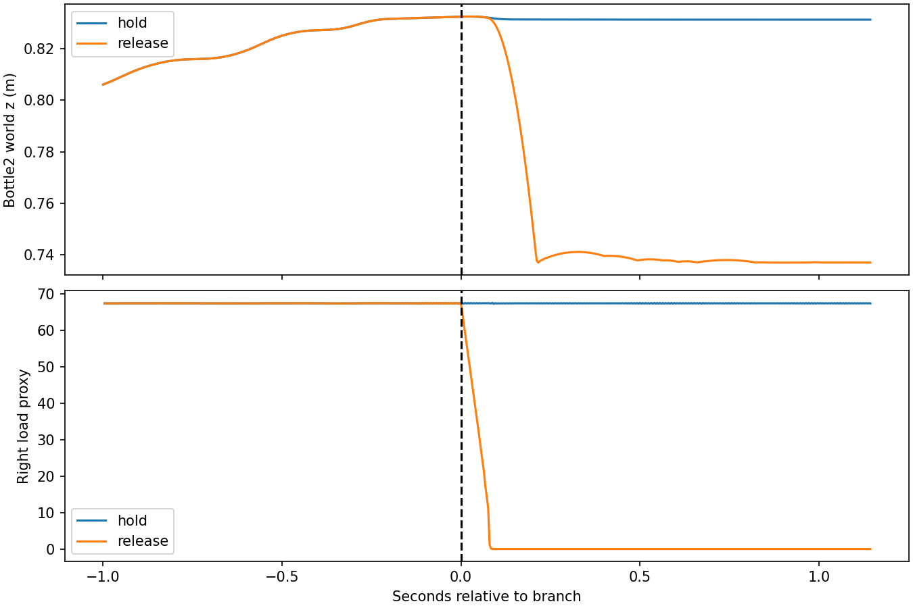

# 封存前缀：保持与释放开发实验

## 方法与数据
复用开发seed100123，重放同一封存抓取/抬升指令，两条件均通过初始/边界可观测状态、RGB和时钟的精确校验。随后各6个命令，仅右夹爪命令可不同；记录物理时长而非假定相等。

## 结果
完整干预前几何、接触和命令记录逐项一致；分支命令非右夹爪分量一致。

- hold：分支286物理步，右瓶高度0.8325→0.8313m。
- release：分支286物理步，右瓶高度0.8325→0.7369m。

## 失败分析与局限
可观测字段相等不覆盖隐藏求解器状态。固定开爪由脚本指定，不能证明触觉贡献；动作/本体历史就可能解释释放。物理时长若不同，不能作相同交互预算的策略比较。仅单开发seed，非独立泛化实验，不直接准入训练。左侧仍有相机接触因素。

## 复现与下一步
work/contact_branch_replay_v1/run.sh hold或release；冻结摘要见同目录manifest。下一步建立相同试抓命令下不同接触结果的有限场景，检验信息可观测性并设计继续搬运/重抓的纠错监督。保留视觉+本体+动作历史基线，避免仅用开爪脚本标签宣称触觉价值。
