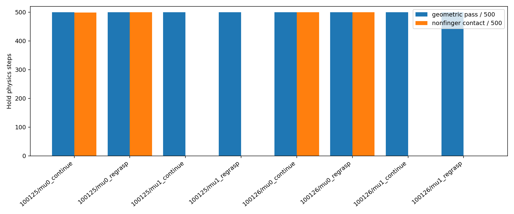

# 三seed接触分支开发矩阵

固定开发seed100124、100125、100126，各先生成一次原始材质探测参考，再执行低/高摩擦×继续/重抓分支与2秒保持。至多15回合，无自动重试或替换seed。实际记录：{'expert_planning_failure': 1, 'completed': 10}。规划失败不等于物理上不可成功；参考失败导致未执行分支必须保留在分母中，不计成策略任务失败，也不能从图表消失后宣称高成功率。

## 配对与证据
同摩擦继续/重抓分支的完整探测前几何及接触记录作精确对比，结果见summary.json。固定动作命令相同并不自动代表状态可比；不匹配分支不可用于严格配对因果比较。每个回合独立图文报告、原始状态、触觉、本体和RGB保留，摘要哈希已记录。

## 解释边界
这些是此前已使用的开发seed，不是独立确认测试；无已训练策略，没有触觉收益结论。几何保持合格、仅手指接触、混合接触分别报告。仍不能用摩擦组别、未接触帧或总体成功标志自动生成空夹/滑落/必须重抓标签。所有记录training_approval=false。

## 后续
根据全矩阵决定采集机制与标签覆盖是否足以支持正式多seed协议；保留规划失败与跳过项。固定同一推理实现，不把缓存数值检查未通过改写为通过。复现入口work/contact_multiseed_summary_v2/run.py；仅当原批次completed时汇总，活动队列或技术暂停不生成完整矩阵结论。
