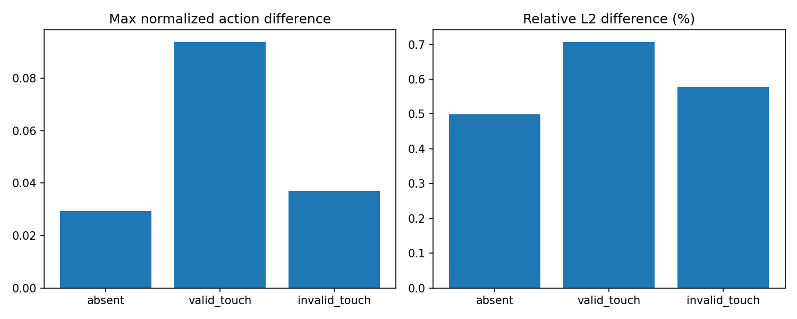

# 完整前向与缓存推理比较

同一个真实开发样本、固定初始化与噪声，比较无新条件、有效触觉、无效触觉三种条件，均为2步BF16去噪。主干及新模块均不更新。完整前向每步重算前缀，缓存推理复用前缀；完整路径第二步反解noise时包含BF16舍入误差，因此首步速度差异也单独保存。

三条件输出有限且缓存重复运行逐位一致，但全部未通过事前atol=0.01、rtol=0.01的逐元素容差。最大归一化动作差分别0.02930、0.09375、0.03711，相对L2约0.499%、0.707%、0.577%。这些不是米或关节角误差，不能直接解释为物理影响。无条件版本也有差异，不能直接认定新增触觉token是唯一原因。

## 决策
不放宽容差或宣称等价，不部署。追加一次明确诊断：相同首步输入下，比较实际传入专家的suffix嵌入、动作查询注意力掩码与位置编码；区分接线差异与底层BF16/缓存计算差异。即使输入完全相同，也不能只靠这个结果证明闭环无影响。没有正式训练或任务收益结论。

## 复现
work/contact_temporal_cache_gate_v1/run.py及manifest.json，输出张量保留在本目录三个_outputs.pt；脚本无优化器更新。对照不与历史不同seed的任务成功率合并。
