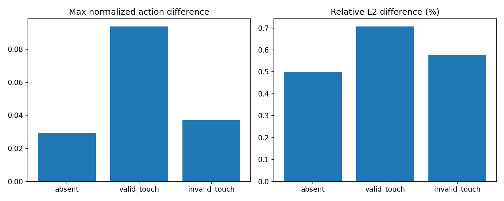

# 缓存差异定位：首步实际输入核验

在真实预训练模型上拦截实际专家forward调用参数，不修改参数；比较同一首步噪声下完整前向与缓存推理。三种条件（无条件模块、有效触觉、无效触觉）的suffix嵌入、动作查询完整注意力掩码、suffix位置编码全部逐位相同，共9/9项通过。缓存重复推理输出逐位相同。

输出差异与上一检查一致，三条件仍未通过原数值容差。本证据排除了本样本首步三类显式输入不一致，尚未比较前缀缓存内部所有层的状态，不能宣称已证明纯BF16舍入原因或两种实现等价。无新token时同样存在差异，不宜将该结果直接解释为触觉模块失败。

## 决策
停止重复同一缓存对照，保留数值一致性未通过的记录。后续研究对照固定同一推理实现、精度及去噪步数；不同执行路径不得混合比较。正式部署前仍需处理数值门槛与闭环影响。当前可继续独立数据采集与训练接口工作，不能以本报告宣称性能收益或部署已获准。

## 复现与限制
work/contact_temporal_cache_trace_v1/manifest.json固定代码和输入，三条件完整输出/指标在本目录。单开发样本、两步去噪，无优化器更新。二次检查未放宽阈值，原模型与checkpoint只读。
