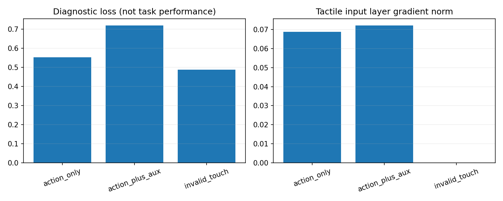

# 真实预训练VLA：触觉条件token梯度检查

使用原视觉checkpoint严格加载及非持久缓冲恢复，只附加新条件编码器；主干冻结。样本right_correction_hold_v1_mu1_regrasp:37，真实同源RGB、触觉、实际本体和动作历史，50个实际执行的候选命令作为诊断目标。三次反向传播，不更新参数、不保存checkpoint，不授权该开发数据用于正式训练。

## 结果
真实动作损失能够传到触觉编码层；加入接触辅助目标亦可反传。无效触觉对照触觉层梯度为零。主干没有梯度或解冻参数。新增参数652037，GPU峰值已分配显存13.774 GiB。详细每层梯度、损失和耗时见result.json。

## 边界与局限
只证明计算路径可训练，不证明训练收敛、动作改善或触觉增益。基础state仍使用旧归一化的已记录命令状态保持加载兼容，实际本体通过独立token输入；后续正式协议必须明确二者。语言指令在诊断脚本中指定。动作来自规则候选，标签尚未准入。缓存推理一致性、正式多seed训练和闭环尚未完成，不自动部署新模型。

## 复现
work/contact_temporal_real_gate_v2/manifest.json锁定代码与连接数据SHA；run.sh使用自有GPU租约和30分钟上限；原checkpoint只读。完成后只释放自有租约，不操作Strata。报告脚本work/contact_temporal_real_gate_v2/report.py。
