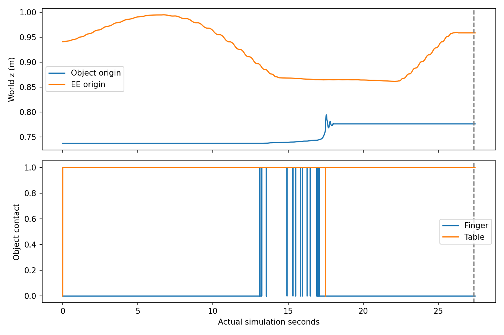

# 修正静态规划世界：实际执行与原失败分支配对

相对原失败分支，采用有限候选筛选并修正纠错规划世界；此处检查共享试抓是否仍严格匹配。对旧失败分支检查初态、RGB、探测边界及完整几何/接触记录，不能仅凭相同seed和相同命令声称配对。详细结果见summary.json。所有物体几何与接触对象信息仅作监督审计，未训练策略。

图中竖线为开始纠错前边界。物体原点高度仅作运动诊断，正式右目标几何判定使用功能点，同名回合报告单独记录2秒保持。规划成功不等于接触成功，接触不等于持物，右目标成功不等于双臂完整任务成功。候选阶段命令统计不是完成阶段证明，必须结合终局失败/保持文件解读。

此次仅一个已使用开发seed。成功时可以作为后续有限多seed教师验证的依据，但不能据此宣称触觉收益或批准全部探测/候选动作训练。失败时保留具体阶段，禁止将继续调参数直到成功当作测试。复现入口work/corrected_world_outcome_audit_v2/run.py。

## 结果与决策
两臂单/批规划世界均成功重建，包含真实桌板、4桌腿、墙体，安装前后物理可观测状态不变。8候选中0/2/3/4/6/7没有可行预抓取，1/5最终接近失败；只执行一次打开，未再次执行向桌面的接近。旧曾选候选2被正确世界拒绝，但尚不证明机器人碰撞球完全准确。新旧整个试抓状态、RGB、几何/接触配对严格通过。 当前姿态对现有有限候选专家不可恢复，不是物理上不可抓取的证明。停止本偏移场景的重复调参；保留空夹辨识证据，但不作为成功恢复示范。下一项仅检查同一资产未扰动初态的候选可行性，若仍无可行解，优先修正资产抓取点/碰撞模型与教师，而不是扩大训练或挑seed。
