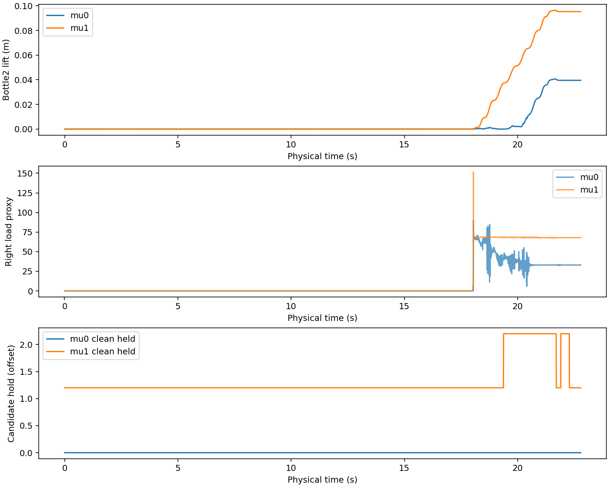

# 固定试抓与物体侧摩擦：开发可观测性实验

## 方法与数据
开发seed100123，固定全部试抓及保持命令，只改变右瓶碰撞形状的静/动摩擦系数0或1，恢复系数保持不变。两条件初始可观测状态/RGB与参考精确一致，全部实际输入命令相等；物理时间及结果按实测。物理参数只记录在标签旁路，未训练策略。

## 结果


```json
{
  "mu0": {
    "steps": 5696,
    "actions": 53,
    "duration_s": 22.78400108218193,
    "object_material": 0.0,
    "initial_z": 0.7369327545166016,
    "final_z": 0.7764855623245239,
    "max_lift_m": 0.04066002368927002,
    "held_candidate_steps": 380,
    "clean_held_candidate_steps": 0,
    "other_contact_steps": 1030,
    "other_entities": [
      "fr_link6",
      "right_camera"
    ],
    "label_sha256": "5359a690dbe71f0aaf169f1c0ac7e81a8cb3dc1979a2ae24c781560dd16c7d68"
  },
  "mu1": {
    "steps": 5696,
    "actions": 53,
    "duration_s": 22.78400108218193,
    "object_material": 1.0,
    "initial_z": 0.7369327545166016,
    "final_z": 0.8322191834449768,
    "max_lift_m": 0.09648019075393677,
    "held_candidate_steps": 852,
    "clean_held_candidate_steps": 677,
    "other_contact_steps": 16,
    "other_entities": [
      "right_camera"
    ],
    "label_sha256": "da4f74431ce8f8ce081ef96921bcc2ff1e476381cc18c929341ce95faeff94d6"
  }
}
```

## 失败分析与局限
对象侧摩擦系数不是有效接触对摩擦的标定值；手指/桌面材质和引擎组合规则仍有影响。固定相同命令不保证相同真实关节轨迹。候选保持阈值是开发值，其他部件接触单独记录。单开发seed不能证明触觉优于视觉/本体/动作历史，也不能把物理步数当独立样本量。无论两条件结果是否不同，都不继续无界搜索正例。

## 复现与下一步
work/fixed_probe_friction_v2/batch.py，冻结manifest包含协议、参考指令和源码摘要。每回合保留材质读回、初始审计、接触、几何和相机记录。下一步核对事件与输入可观测差异，决定是否构建独立多seed数据；不得直接将当前开发轨迹批准为纠错专家标签。原比赛仓库只读，不自动操作Strata。
