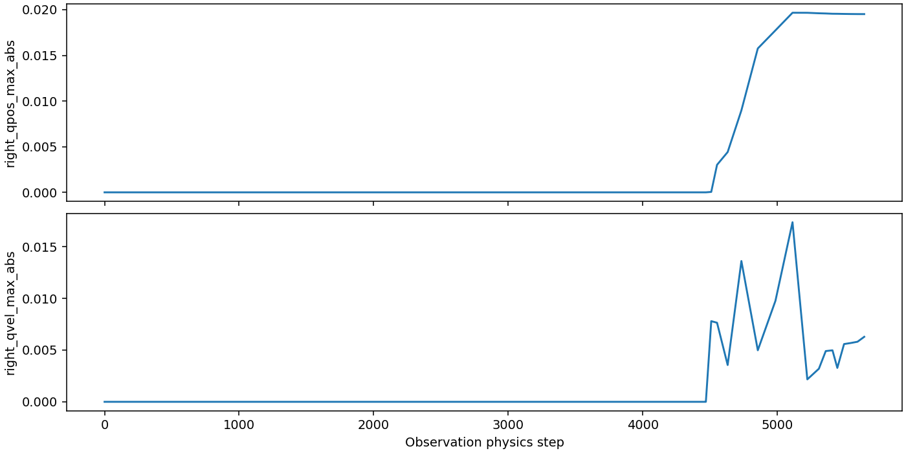

# 实际本体采集与重复性核验

## 方法与数据
两种固定摩擦开发条件重复采集，在逐物理步记录中单独保存实际qpos/qvel、关节名称与DOF；不把物体真值写入本体流。按保存相机的同一物理步比较右侧全部活动关节，包括夹爪。

## 结果

{
  "instrumentation_reproduction": {
    "mu0": {
      "all_label_geometry_equal": false,
      "all_force_equal": true,
      "all_events_equal": true,
      "proprio_sha256": "1325a969213fc8a363a730f7d2697e49c51d63e03c16cc9850e477c411c2ef3c"
    },
    "mu1": {
      "all_label_geometry_equal": false,
      "all_force_equal": true,
      "all_events_equal": true,
      "proprio_sha256": "f9bfd54ca1f7f98fdcb74e7ffaa3d287ab9e32dd5265d08a6c37259b1e11c84e"
    }
  },
  "first_observed_measured_difference": {
    "obs_index": 37,
    "physics_step": 4509,
    "right_qpos_max_abs": 4.548951983451843e-05,
    "right_qvel_max_abs": 0.007799088954925537,
    "per_joint_abs": {
      "right_wheel": 0.0,
      "left_wheel": 0.0,
      "fl_castor_wheel": 0.0,
      "fr_castor_wheel": 0.0,
      "rr_castor_wheel": 0.0,
      "rl_castor_wheel": 0.0,
      "fl_joint1": 0.0,
      "fr_joint1": 4.500150680541992e-06,
      "lr_joint1": 0.0,
      "rr_joint1": 0.0,
      "fl_wheel": 0.0,
      "fr_wheel": 0.0,
      "rr_wheel": 0.0,
      "rl_wheel": 0.0,
      "fl_joint2": 0.0,
      "fr_joint2": 2.6464462280273438e-05,
      "lr_joint2": 0.0,
      "rr_joint2": 0.0,
      "fl_joint3": 0.0,
      "fr_joint3": 1.430511474609375e-06,
      "lr_joint3": 0.0,
      "rr_joint3": 0.0,
      "fl_joint4": 0.0,
      "fr_joint4": 2.6226043701171875e-06,
      "lr_joint4": 0.0,
      "rr_joint4": 0.0,
      "fl_joint5": 0.0,
      "fr_joint5": 1.5288591384887695e-05,
      "lr_joint5": 0.0,
      "rr_joint5": 0.0,
      "fl_joint6": 0.0,
      "fr_joint6": 1.586228609085083e-05,
      "lr_joint6": 0.0,
      "rr_joint6": 0.0,
      "fl_joint7": 0.0,
      "fl_joint8": 0.0,
      "fr_joint7": 4.548951983451843e-05,
      "fr_joint8": 1.8477439880371094e-06
    }
  },
  "training_approval": false
}

## 局限与失败分析
最大值可能混合旋转/移动关节单位，完整逐关节差异见JSON，不能作为统一物理距离。精确浮点不同不等于可学习信号；本实验不做分类准确率或触觉独立收益推断。新增记录的重复性逐字段报告，不以相同终态代替全轨迹。

## 复现与下一步
work/fixed_probe_friction_v2/audit_proprio.py。下一步据完整传感输入设计独立场景采集，并用视觉+实际本体+动作历史基线检验触觉辅助目标与纠错动作学习；不将本单对开发条件随机切窗当训练测试集。

## 接触对差异复核完成
全记录审计见../contact_pair_order_audit_v1/report.md：mu0的509行、mu1的38行原始差异全部仅为object_contact_pairs列表顺序。仅对列表按完整记录排序后，5697行全部字段精确相等；保留重复项、接触方向和浮点值，不修改源文件。结合原先force/events精确相等，新增本体记录未改变本次保存的轨迹值。不能扩展为未记录隐藏状态完全一致。
