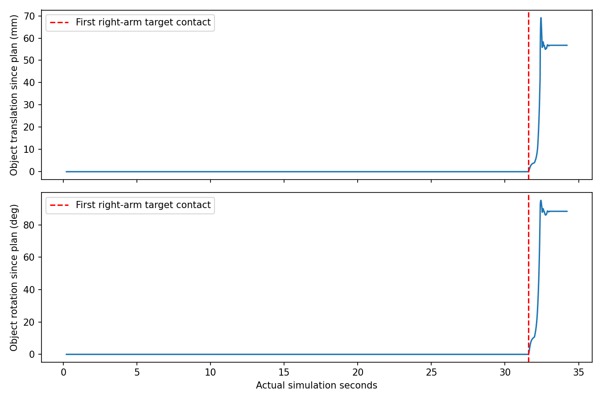

# 预抓取改变目标：原抓取计划已过期

使用既有记录，比较生成抓取动作时与预抓取结束时的瓶体位姿，标出首次右臂与目标接触。实际TCP到达原预抓取目标，并不保证瓶体仍处于原计划姿态。物体真值仅用于离线监督审计，不进入学习器。



```json
{
  "pregrasp_start_step": 50,
  "pregrasp_end_step": 8552,
  "first_right_target_contact_step": 7900,
  "object_translation_m": 0.05677071243749943,
  "object_rotation_deg": 88.44071346683465,
  "stale_to_same_object_relative_target_displacement_m": 0.12219753420879527,
  "same_object_relative_target_world_pose": [
    -0.03428213043632733,
    -0.07221259569752098,
    0.740550440927781,
    0.4359660049489377,
    -0.312828672134329,
    -0.6522029135117844,
    0.535446751812237
  ],
  "transformed_target_is_not_approved_action": true,
  "source_sha256": "b747ad8b1e9807f16f407dd748e6235db0c61f383f8fba62934ba69f67e1d030",
  "training_approval": false
}
```

同一对象相对目标的刚体变换仅用于量化原目标过期程度，不是可直接执行的新抓取方案。该新姿态可能不可达或碰撞，必须重新验证。离线求解出旧目标路径不能使它成为正确专家监督，因此停止把旧目标的规划成功率当作主要修复方向。

下一步优先补齐预抓取阶段的目标碰撞建模与计划失效检测；接触后重新观测/规划是候选专家所需机制。触觉可用于意外接触提示，但本报告尚未比较视觉/本体可观测性，不能据此宣称触觉独有或更早。复现work/grasp_target_staleness_audit_v1/run.py。

## 教师有效性门槛实现
新增grasp_target_freshness.py，显式位置/旋转阈值，仅用于特权教师动作有效性，不作策略输入。4项CPU测试覆盖四元数符号等价、位移、旋转、非有限数据；对本回合按5mm/5度开发阈值判定fresh=false。该阈值是观察本开发数据后提出的工程门槛，非事前评测标准或校准标签；不能据此报告分类准确率。实现尚未接入新采集器，后续需在独立开发回合验证并冻结。
