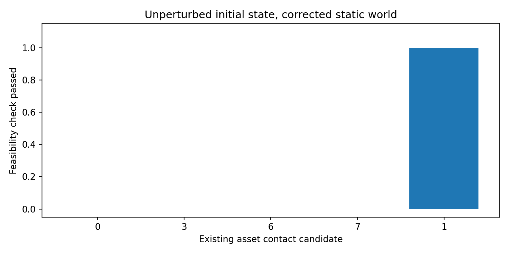

# 未扰动初态的有限抓取可行性

固定既有开发seed100125和同一CWMJ资产，不移动目标、不回放试抓、不执行动作。先读取真实静态盒体重建左右单/批规划世界，再用固定顺序最多8个原资产接触候选检查预抓取与预测终点的最终接近。遇到首个可行候选即停止，不能把未检查候选算成失败。

结果：{"feasible": true, "action_types": ["move", "move", "gripper"]}。实际执行命令0条，物理步数0，检查前后可观测状态精确不变。summary.json记录检查与选择，world_install.json保留实际规划world。

若存在候选，说明当前资产在此初态并非全部候选都无解，不能据此保证动作执行或扰动后恢复；若没有候选，也只说明当前专家/模型未找到解，不证明物理不可抓取。不得作为独立测试或触觉收益结果，不批准训练。此项用于决定下一步检查资产契约还是有限初态执行，禁止继续扫描扰动直到出现成功。

复现work/initial_grasp_feasibility_v1/run.sh 100125 mu1_regrasp。原比赛仓库/checkpoint只读，不操作Strata。
