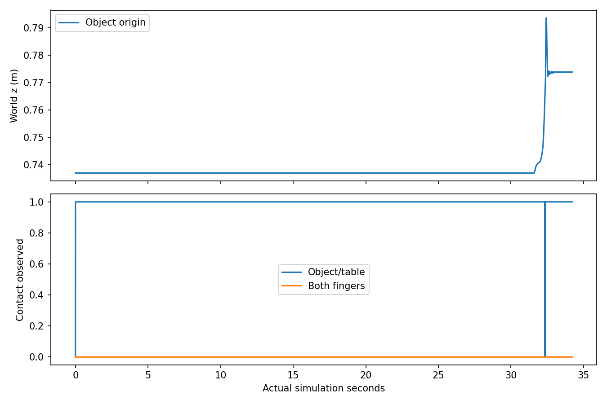

# 正确静态world下实际初态抓取、抬升与保持

固定seed100125，未扰动初态、有限资产候选专家，执行抓取、抬升0.1米及最后目标保持2秒。不执行放置，旧模板的右目标区域指标不适用于本实验。报告实际连续位移、接触对象和保持漂移，不以原放置任务成功阈值筛选结果。



```json
{
  "batch": {
    "status": "completed",
    "records": [
      {
        "seed": 100125,
        "condition": "mu1_regrasp",
        "status": "expert_planning_failure",
        "failure": {
          "type": "OnlineExpertPlanError",
          "error": "right current-state path planning failed",
          "training_approval": false
        }
      }
    ],
    "time": 1794310386.6045015,
    "training_approval": false
  },
  "training_approval": false,
  "failure": {
    "type": "OnlineExpertPlanError",
    "error": "right current-state path planning failed",
    "training_approval": false
  },
  "right_table_contact_steps": 0
}
```

物体由双指接触且离桌，与仅几何位置合格分别判断；物体相对末端漂移是描述量，未校准为滑落风险标签。本实验是单开发seed专家质量检查，没有训练策略、恢复分支比较或触觉增益结论。成功也不能将所有探测/闭合动作自动准入正式训练，失败不自动更换seed。

复现入口work/initial_grasp_hold_audit_v1/run.py；原始事件、逐步触觉/实际本体、RGB和仅监督几何保留。原比赛仓库/checkpoint只读，不操作Strata。

## 实际结论
实际回合止于最终接近规划，未闭合、未抬升、未进入保持；预抓取末端到达误差约1.997mm/0.274度（原gripper坐标转换），整个回合右臂与桌面接触0步。静态预测终点可行不能替代实测状态可行，不能以“规划筛选通过”批准专家示范。 下一步使用已存correction_plan_context的完整qpos、目标与规划world离线复现最终接近，不重放物理动作；需要保存原始MotionGen失败原因。
