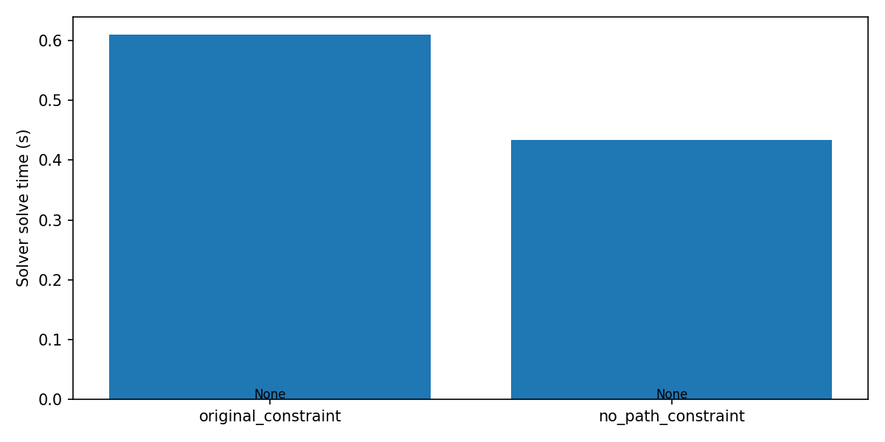

# 保存实测状态的离线最终接近诊断

使用初态执行失败时保存的完整关节qpos、原目标、真实静态world和机器人配置，分别新建固定seed的冷启动规划器，对比原路径姿态约束与不加路径约束。保留原MotionGen结果。没有初始化仿真、执行动作或修改物理状态。



```json
[
  {
    "condition": "original_constraint",
    "wrapper_status": "Success",
    "path_length": 177,
    "solver": [
      {
        "status": "None",
        "valid_query": true,
        "success": [
          true
        ],
        "position_error": 7.867546628403943e-06,
        "rotation_error": 4.001812612841604e-06,
        "solve_time": 0.6100516319274902,
        "ik_time": 0.04747796058654785,
        "graph_time": 0.4239389896392822,
        "trajopt_time": 0.10716009140014648,
        "attempts": 8
      }
    ],
    "physics_step_source": 8552
  },
  {
    "condition": "no_path_constraint",
    "wrapper_status": "Success",
    "path_length": 920,
    "solver": [
      {
        "status": "None",
        "valid_query": true,
        "success": [
          true
        ],
        "position_error": 5.171867542230757e-06,
        "rotation_error": 6.287849373620702e-06,
        "solve_time": 0.4336428642272949,
        "ik_time": 0.0414278507232666,
        "graph_time": 0.2859804630279541,
        "trajopt_time": 0.07439112663269043,
        "attempts": 7
      }
    ],
    "physics_step_source": 8552
  }
]
```

冷启动不复现原求解缓存/随机历史，不能宣称逐位重现在线调用；一次返回仅用于定位。若有候选路径，只本地保存，不执行、不当成专家训练标签。若不加约束成功，也不自动采用，仍需物理执行与接触验证。复现work/offline_approach_diagnosis_v1/run.sh 100125 mu1_regrasp；manifest保存状态与world输入SHA。
