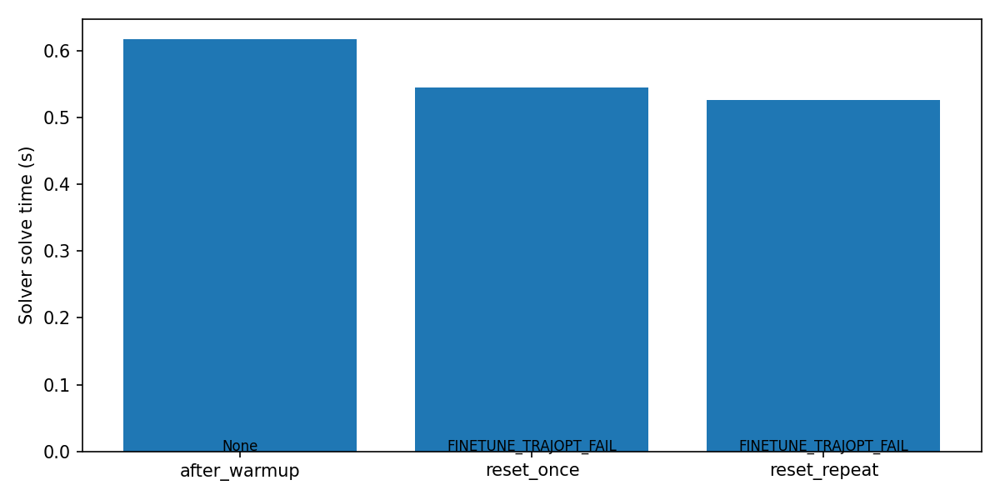

# 保存实测状态的离线最终接近诊断

使用初态执行失败时保存的完整关节qpos、原目标、真实静态world和机器人配置，使用同一个规划器，原约束固定，依次查询warmup后、reset(reset_seed=True)后、再次相同reset后，不自动增加预算。保留原MotionGen结果。没有初始化仿真、执行动作或修改物理状态。



```json
[
  {
    "condition": "after_warmup",
    "wrapper_status": "Success",
    "path_sha256": "52a888744cbaa196c7af952518978a0dd16846a2a107f025912b98f5f5a7d6dc",
    "path_length": 177,
    "solver": [
      {
        "status": "None",
        "valid_query": true,
        "success": [
          true
        ],
        "position_error": 7.867546628403943e-06,
        "rotation_error": 4.001812612841604e-06,
        "solve_time": 0.6169633865356445,
        "ik_time": 0.04836273193359375,
        "graph_time": 0.42972540855407715,
        "trajopt_time": 0.10782814025878906,
        "attempts": 8
      }
    ],
    "physics_step_source": 8552
  },
  {
    "condition": "reset_once",
    "wrapper_status": "Fail",
    "path_sha256": null,
    "path_length": null,
    "solver": [
      {
        "status": "MotionGenStatus.FINETUNE_TRAJOPT_FAIL",
        "valid_query": true,
        "success": [
          false
        ],
        "position_error": [
          2.1108378405187977e-06
        ],
        "rotation_error": [
          1.7637006521908916e-06
        ],
        "solve_time": 0.5447630882263184,
        "ik_time": 0.06020331382751465,
        "graph_time": 0.3878328800201416,
        "trajopt_time": 0.09672689437866211,
        "attempts": 10
      }
    ],
    "physics_step_source": 8552
  },
  {
    "condition": "reset_repeat",
    "wrapper_status": "Fail",
    "path_sha256": null,
    "path_length": null,
    "solver": [
      {
        "status": "MotionGenStatus.FINETUNE_TRAJOPT_FAIL",
        "valid_query": true,
        "success": [
          false
        ],
        "position_error": [
          2.1108378405187977e-06
        ],
        "rotation_error": [
          1.7637006521908916e-06
        ],
        "solve_time": 0.525836706161499,
        "ik_time": 0.05956292152404785,
        "graph_time": 0.36792778968811035,
        "trajopt_time": 0.09834599494934082,
        "attempts": 10
      }
    ],
    "physics_step_source": 8552
  }
]
```

冷启动不复现原求解缓存/随机历史，不能宣称逐位重现在线调用；一次返回仅用于定位。若有候选路径，只本地保存，不执行、不当成专家训练标签。若不加约束成功，也不自动采用，仍需物理执行与接触验证。复现work/offline_planner_reset_gate_v1/run.sh 100125 mu1_regrasp；manifest保存状态与world输入SHA。

## 固定预算结果
同一个保存状态与原姿态约束：冷启动warmup后成功（177路径点，8次内部尝试）；调用reset(reset_seed=True)后连续两次固定查询均失败（各10次内部尝试），没有第三次重试。重置可复现失败并不意味着能改善可行性，因此不采用“每次reset就能修复”的推断。冷启动成功也不能视为在线调用的逐位复现。 后续需要固定求解初始化及预算作为教师协议，不按失败后是否成功挑选结果；本轮没有机器人动作或专家训练准入。
