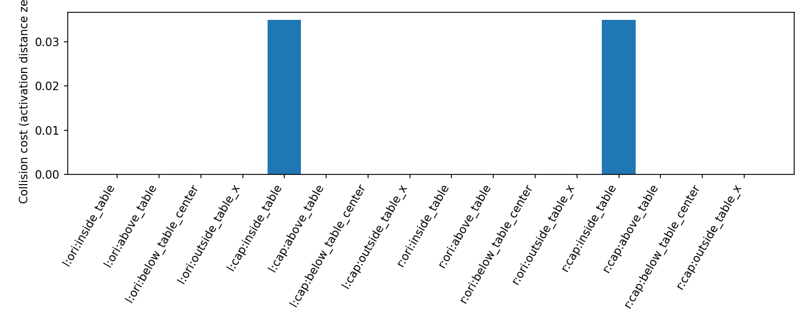

# 捕获世界的碰撞查询门槛

读取已捕获的真实桌板、四条桌腿和墙体，分别构建左右臂独立RobotWorld，缓存容量8。以半径1厘米球在桌板内部、上方、桌板下方中部、桌外进行静态查询，activation_distance=0，正值表示相交。预期由实际世界坐标及桌板尺寸预先确定，未执行机器人动作。

summary.json保留16次查询（两臂×原/捕获世界×四点）及逐项预期。这只验证静态世界位置与球查询，不验证机器人碰撞球覆盖真实URDF、完整动作路径或任务恢复。左右world.json可供独立规划实例加载，需同时配置单/批规划，不能直接扩容旧CUDA graph缓存。原比赛仓库/checkpoint未修改，无训练，无Strata操作。

复现work/planner_collision_query_gate_v1/run.sh 100125 mu1_regrasp，manifest锁定脚本和几何源。
