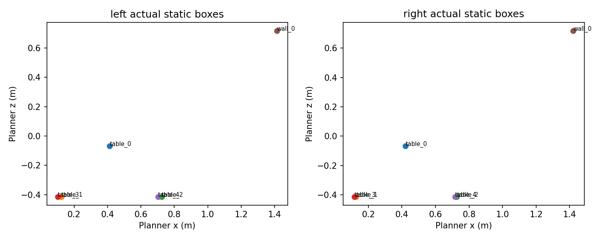

# 实时静态碰撞形状与规划坐标捕获

初始化固定开发seed100125，读取实际PhysX静态实体的每个box碰撞形状，将entity pose与shape local pose组合为世界姿态，再按该臂原规划目标的root逆变换、frame_bias及z微旋转转换。不调用动作、不额外推进物理时钟、不更新任何规划器。读取前后可观测状态精确相同，每个形状执行往返变换检查，尺寸保持不变。

捕获数量：{"left": {"table": 5, "wall": 1}, "right": {"table": 5, "wall": 1}}。summary.json保存各box完整尺寸、世界姿态、规划姿态、变换矩阵和往返误差。桌面、桌腿、墙体全部保留；不能用参考中心0.74米代替实际桌面碰撞中心，因为桌板有局部厚度偏移。

v1首次读取因原配置根四元数0.707精度未通过1e-4单位范数检查而停止；v2允许1e-3内的配置精度误差，quat2mat按原方法归一化，不修改物理姿态。此项只校正输入表示校验，不能视为放宽碰撞或任务成功阈值。

v2捕获时发现任务对象为Actor包装而非直接Entity，v3显式读取其actor实体，保留原失败日志。

下一步将这些实际形状用于实验命名空间中单/批规划世界，核验障碍物数量、姿态与碰撞查询。原规划world尚未更新，碰撞一致性和纠错恢复仍未验证。原比赛仓库/checkpoint只读，结束只释放自有GPU租约，不操作Strata。复现入口work/planner_static_world_capture_v3/run.sh 100125 mu1_regrasp。
