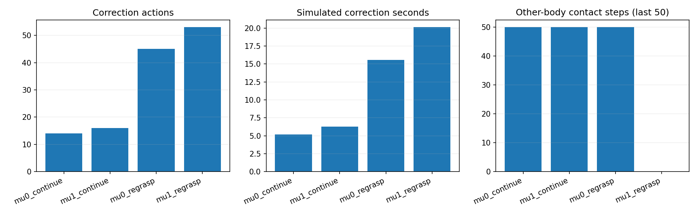

# 继续与重抓：有限开发分支比较

同一开发seed100123、同一物体和固定探测动作，瓶体侧摩擦系数0/1 × 继续/重抓。候选专家使用特权几何，不是已训练VLA，也不是触觉触发决策。

|条件|右瓶终点几何合格|动作数|模拟秒|末50步其他物体接触|
|---|---|---:|---:|---:|
|mu0_continue|True|14|5.184|50|
|mu1_continue|True|16|6.280|50|
|mu0_regrasp|True|45|15.560|50|
|mu1_regrasp|True|53|20.112|0|

## 配对审计
{"mu0": {"through_step": 5696, "canonical_label_mismatches": 0, "first_mismatch": null, "scope": "recorded geometry and object contacts only; not hidden simulator state"}, "mu1": {"through_step": 5696, "canonical_label_mismatches": 0, "first_mismatch": null, "scope": "recorded geometry and object contacts only; not hidden simulator state"}}

## 解释与限制
终点按原任务功能点几何子判据计算，不能替代完整双瓶任务成功或稳定抓持。末50步只是约0.2秒动作执行尾段的诊断，并非独立静止保持试验；相对位置漂移小也不能排除非指尖支撑。任何接触污染、共享前缀不一致或缺少分支优势都阻止直接生成唯一正确动作标签。两分支都成功时应保留成本与等价性，不强制重抓；两分支都失败时没有合格专家标签。单seed结果不证明泛化或触觉增益。

## 本轮结论与后续
四条件终点均合格。同摩擦两分支在决策前5697条几何/接触记录一致（接触列表顺序规范化）。mu0_continue末50步持续接触fr_link6；mu1_continue及mu0_regrasp末50步持续接触right_camera；mu1_regrasp该窗口仅接触手指。记录的是接触存在，不足以独立证明非指尖支撑承担了多少载荷。重抓模拟成本为15.56/20.112秒，继续为5.184/6.28秒。当前没有依据把低摩擦定义为必须重抓，也不能把非指尖接触的终点成功直接用作可靠抓持标签。下一步先开发可审计的接近几何和独立保持阶段，保留原碰撞几何做对照，不通过删除碰撞体制造成功。未经独立保持与多seed验证，不扩大正式采集或训练。

## 复现
运行work/right_correction_comparison_v1/run.py；依赖四份完整轨迹及各自功能点报告，缺失或失败即拒绝汇总，逐轨迹SHA见summary.json。
