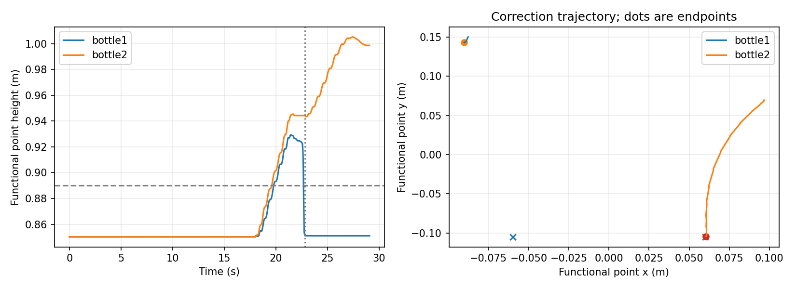

# 右臂mu1_continue：功能点终态审计

## 问题与方法
单个开发seed 100123，条件mu1_continue；固定探测后执行冻结的对应分支。此处只审计已完成轨迹，不重新训练或选择成功样本。按原Actor.get_point公式，使用记录的世界位姿、资产functional_matrix及scale重建功能点，直接使用同环境Sapien位姿变换；不是用瓶体原点替代功能点。共7267个连续物理步记录，纠错起点5696。

## 结果
右瓶终点功能点为[0.06048889541933223, -0.1042844738962841, 0.9986787167371606]米；XY绝对误差为[0.0004888954193322317, 0.0007155261037158911]米。原任务右瓶几何子判据（XY误差各小于0.1米，Z大于0.89米）为 **True**。完整双瓶任务成功为False。两者分开报告，不能由整体失败反推单臂失败。

## 限制与下一步
这是同一开发seed的专家候选轨迹，无学习策略、无触觉决策、无提升结论。终点几何合格也不证明稳定保持或完整任务成功。瓶体侧摩擦系数不是接触对有效摩擦。低摩擦探测存在非指尖接触污染；现阶段不批准训练。下一步以冻结的同一探测动作检查高摩擦继续及两种重抓分支，核验前缀一致性与恢复后的保持，而不是把候选专家直接当作正确标签。

## 复现
`/mnt/relaydata/lingbot/conda/envs/lingbot-eval310/bin/python work/right_correction_report_v1/run.py mu1_continue`

输入、脚本和原判据源码SHA256见summary.json；原轨迹保持只读。
