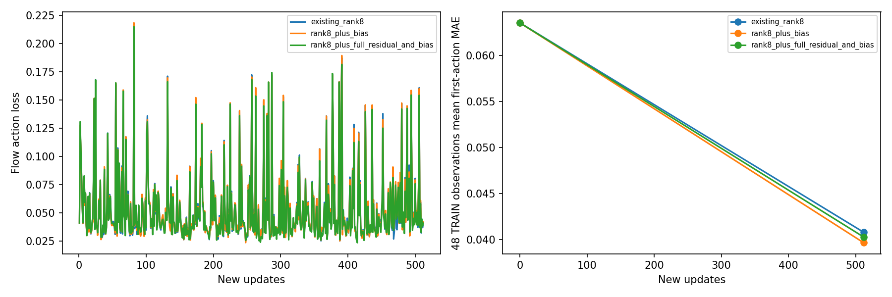

# 动作输出层适配容量对照

同一3456步联合触觉权重、同数据与噪声、重置相同AdamW设置，三组各512更新。控制组原rank8；第二组额外输出bias；第三组额外完整输出权重残差及bias。新残差零初始化，保留旧LoRA。原骨干冻结，计算精度和10步采样不变。



```json
{
  "status": {
    "status": "completed",
    "completed_arms": [
      "existing_rank8",
      "rank8_plus_bias",
      "rank8_plus_full_residual_and_bias"
    ],
    "arm": "rank8_plus_full_residual_and_bias",
    "step": 512,
    "elapsed_s": 989.7752161370008,
    "matched_updates": true
  },
  "groups": {
    "existing_rank8": {
      "updates": 512,
      "diagnostics": {
        "0": {
          "observations": 48,
          "mean_mae": 0.11762114986777306,
          "mean_first_mae": 0.06356017066476245
        },
        "512": {
          "observations": 48,
          "mean_mae": 0.08444993601491053,
          "mean_first_mae": 0.04081719578243792
        }
      }
    },
    "rank8_plus_bias": {
      "updates": 512,
      "diagnostics": {
        "0": {
          "observations": 48,
          "mean_mae": 0.11762114986777306,
          "mean_first_mae": 0.06356017066476245
        },
        "512": {
          "observations": 48,
          "mean_mae": 0.08192818068588774,
          "mean_first_mae": 0.03967780348223945
        }
      }
    },
    "rank8_plus_full_residual_and_bias": {
      "updates": 512,
      "diagnostics": {
        "0": {
          "observations": 48,
          "mean_mae": 0.11762114986777306,
          "mean_first_mae": 0.06356017066476245
        },
        "512": {
          "observations": 48,
          "mean_mae": 0.07841622084379196,
          "mean_first_mae": 0.040298177006964885
        }
      }
    }
  }
}
```

诊断覆盖48条训练观测但固定一个噪声；同一状态可能对应多个动作分支，因此不是48个独立场景。训练拟合改善不代表触觉收益或闭环成功，需要后续保留验证与负对照。新权重含输出残差，不能用旧的四前缀加载器静默忽略；后续推理必须安装相同包装器并严格校验键。

## 权重审计补充

`checkpoint_audit.json` 与可复现脚本 `work/cwmj_action_capacity_probe_v1/audit.py` 已核验：源 checkpoint SHA 未变，三组初始参数与源权重完全一致，新增残差初始为零；48 条初始预测的动作张量逐位一致（不比较运行耗时）。三组最终均为 512 步，控制组新增参数保持零，偏置组仅新增偏置变化，全残差组新增权重和偏置均变化，最终策略与完整训练 checkpoint 对应参数完全一致且有限。已记录每份策略 SHA256。

骨干冻结依据为运行脚本的 requires_grad 前缀白名单；本次未保存完整骨干前后哈希，不能声称已完成逐张量骨干不变审计。该审计仅确认对照与产物一致性，不证明闭环能力。
