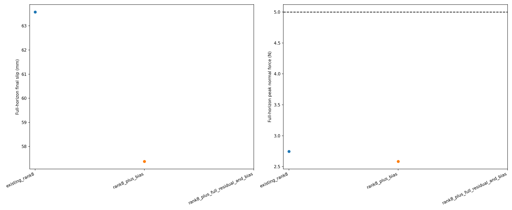

# 输出层容量闭环开发对照：2场景×2扰动×3组

任务状态：completed；已记录12/12回合。

|配置|已运行/计划|完整窗口|同时过稳定及力门槛|完整窗口滑移中位数mm|
|---|---:|---:|---:|---:|
|existing_rank8|4/4|1|0|63.57757533105605|
|rank8_plus_bias|4/4|1|0|57.376204703938484|
|rank8_plus_full_residual_and_bias|4/4|0|0|None|

每组4回合包含同2个场景的2条件，不能当4个独立seed；完整窗口中位数排除了不完整回合，必须结合失败数看，不能单独据此排名。测试场景保持未用。

三组均使用真实触觉，同起始权重并追加相同512更新；本实验不检验触觉收益。验证场景已有开发反馈，不作为首次盲测。共享ClosureGovernor仍保留真实接触反馈，各组比较学习器额外触觉访问。物理暂停推理，时延不能视为50ms实时控制。

合格稳定保持不等于恢复成功；恢复还需失败先发生及与无纠正分支比较。每回合原命令、准入、19次决策和子步诊断均保留。

各回合图文报告：
- [2001_none / existing_rank8](2001_none/existing_rank8/report.md)
- [2001_none / rank8_plus_bias](2001_none/rank8_plus_bias/report.md)
- [2001_none / rank8_plus_full_residual_and_bias](2001_none/rank8_plus_full_residual_and_bias/report.md)
- [2001_down_1N / existing_rank8](2001_down_1N/existing_rank8/report.md)
- [2001_down_1N / rank8_plus_bias](2001_down_1N/rank8_plus_bias/report.md)
- [2001_down_1N / rank8_plus_full_residual_and_bias](2001_down_1N/rank8_plus_full_residual_and_bias/report.md)
- [2002_none / existing_rank8](2002_none/existing_rank8/report.md)
- [2002_none / rank8_plus_bias](2002_none/rank8_plus_bias/report.md)
- [2002_none / rank8_plus_full_residual_and_bias](2002_none/rank8_plus_full_residual_and_bias/report.md)
- [2002_down_1N / existing_rank8](2002_down_1N/existing_rank8/report.md)
- [2002_down_1N / rank8_plus_bias](2002_down_1N/rank8_plus_bias/report.md)
- [2002_down_1N / rank8_plus_full_residual_and_bias](2002_down_1N/rank8_plus_full_residual_and_bias/report.md)

## 结果解释与下一步

12/12 回合完成记录，耗时171.96秒。原rank8与增加偏置各仅1/4回合完成完整窗口，全矩阵残差组0/4；三组稳定与力门槛同时通过均0/4。完整窗口滑移分别63.58mm、57.38mm，仅各一个样本且存在大量失败，不能据此声称偏置改善稳定性。

输出层扩容降低训练动作序列误差，但未在这两个开发场景提供闭环改善证据。因此暂不扩大该方案的训练预算或评测数量，也不把这次负结果解释为触觉无用。下一阶段优先解决专家动作覆盖不足与训练动作误差到夹爪/关节控制的关系；保留全部权重和回合证据。
