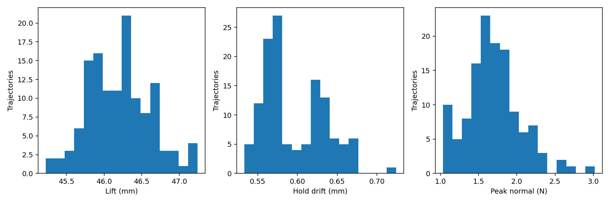

# 完整轨迹扩量采集汇总

128个预留训练场景全部采集完成并通过来源与阶段任务质量检查，共18304个连续50ms转移，128份逐轨迹图文报告。验证与测试场景未采集。



原始数据约3.19 GiB。

相比旧保持数据，覆盖下降、闭合、抬升、保持、放置、释放、撤回的左臂动作；右臂固定，同一资产和同一脚本轨迹仅改变物体初始位姿，不代表128种技能或恢复专家。帧间高度相关，18304个转移不是独立样本。下一步按轨迹构建动作块及有效掩码，避免跨回合窗口、未来信息泄漏和对原始图像重复缓存；此时仍未批准训练入库。

```json
{
  "settle_pre_grasp": 384,
  "descend_to_grasp": 2560,
  "close_fingers": 1280,
  "lift_start_offset": 768,
  "lift": 2560,
  "hold_lift": 3072,
  "place_down": 3840,
  "release": 1280,
  "retract": 2560
}
```
